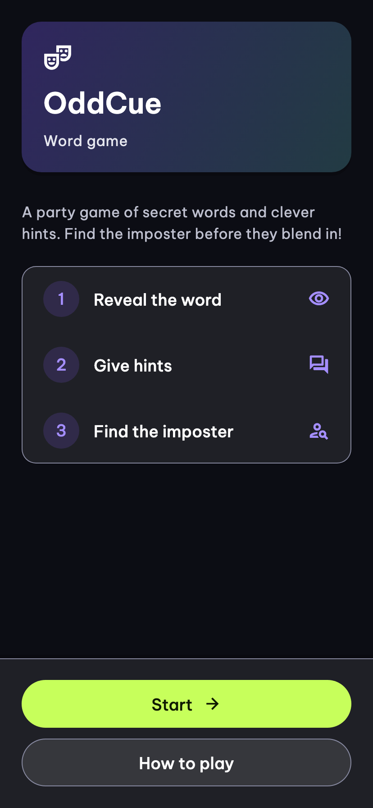
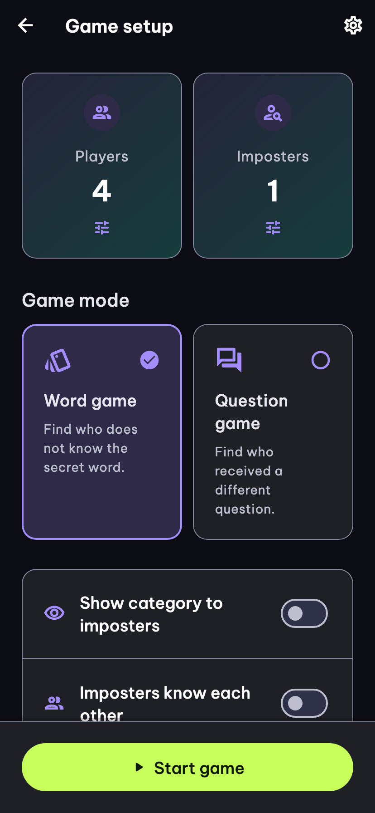
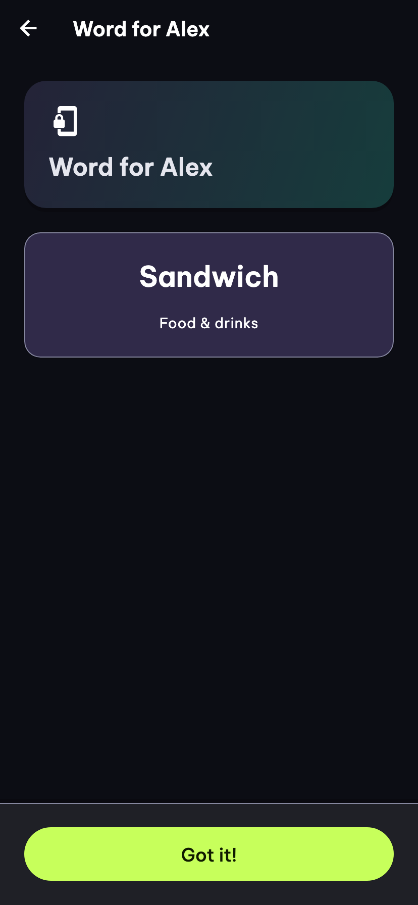

# OddCue


**Spot the odd cue.** A pass-the-phone party game: share clues, compare answers, and find the player who received a different secret.

This repository contains the Flutter mobile app, a Vue content administration dashboard, and the Supabase backend. Players use one shared device; no player account is required.

## App preview

<table>
  <tr>
    <th>Welcome</th>
    <th>Game setup</th>
    <th>Private word card</th>
  </tr>
  <tr>
    <td></td>
    <td></td>
    <td></td>
  </tr>
</table>

These images are rendered from the app's Flutter screens in English with sample content and player names, at a 414 × 896 logical-pixel viewport. They are documentation illustrations, not physical-device captures.

## How to play

1. Choose 3–100 players, a game type, categories, and imposter rules.
2. Pass the device around so each player can open their private card.
3. Give clues or submit answers, then discuss who seems out of place.
4. Reveal the imposters and start another round.

| Game | What players receive | How the round ends |
| --- | --- | --- |
| **Word** | Civilians see the same secret word; imposters see their role without the word. | Select the suspected players. The group wins only when every imposter is correctly selected. |
| **Question** | Players privately receive one of two related questions and submit an answer. | Compare answers against the revealed civilian question, discuss, then reveal roles and the alternate question. There is no scored vote. |

## Features

- **Flexible groups:** edit player names, save player lists, and choose a fixed or random imposter count. Civilians always remain the majority.
- **Optional rules:** let imposters recognize teammates, show them the category, or prevent an imposter from opening the discussion.
- **Categories and Family mode:** choose all or selected categories, with Family filtering for both game types. Family word games can also display word images.
- **Custom content:** create local word categories with optional images and local question categories with paired questions.
- **Vietnamese and English:** choose the content language; the mobile interface follows that selection. Available remote content depends on published translations.
- **Offline play after loading:** content, setup, and player lists are cached locally. Failed refreshes retain previously loaded content. A fresh installation needs content before a game can start.
- **Private cards:** private content is concealed when the app goes into the background. Question answers and in-progress game sessions are not persisted or uploaded.
- **Content administration:** authenticated admins manage categories, words, question pairs, translations, publication status, and word images through the web dashboard.

## Repository layout

```text
app/                    Flutter mobile app for Android and iOS
  lib/features/         Setup, word/question games, custom content, settings
  lib/data/             Content loading, local persistence, image caches
  lib/l10n/             Vietnamese and English interface translations
  test/                 Unit and widget tests
  integration_test/     Device integration smoke tests
admin/                  Vue content administration dashboard
  src/                  Views, components, APIs, and generated database types
  tests/                Admin tests and local Storage integration checks
supabase/               Database configuration, migrations, seeds, SQL tests
  scripts/              Local image seeding and admin access helpers
postman/                Backend HTTP mocks and simulations
docs/                   Setup guides, feature contracts, and implementation notes
```

Run Flutter commands in **`app/`**, Yarn commands in **`admin/`**, and Supabase commands at the **repository root**.

## Technology

| Area | Stack |
| --- | --- |
| Mobile | Flutter / Dart, Material, Signals for state, Riverpod for dependency injection |
| Local persistence | Hive CE, local image files |
| Admin | Vue 3, TypeScript, Vite, Nuxt UI, Tailwind CSS, TanStack Vue Query, Vue I18n, Zod |
| Backend | Supabase: PostgreSQL, Auth, Row Level Security, RPCs, private Storage |

The mobile app reads published content anonymously. Admin writes require an active admin account and use transactional RPCs with conflict checks. Word images are stored in the private `word-prompt-images` bucket and downloaded through signed URLs.

## Run locally

### Prerequisites

- Flutter **3.41+** and Dart **3.11+**, with Android tooling or macOS/Xcode for iOS.
- Node.js **22.12+** and Yarn **1.22.22** for the admin dashboard.
- Supabase CLI and a running Docker-compatible runtime for the local backend.
- Python 3 if you want to upload the bundled sample word images.

### 1. Start the backend

From the repository root:

```sh
supabase start
```

For an existing local stack, apply pending repository migrations:

```sh
supabase migration up --local
```

The default local API is `http://127.0.0.1:54321`; Supabase Studio is `http://127.0.0.1:54323`. The configured seeds provide sample Vietnamese/English content for new databases. To upload the bundled word images and apply the main sample-content seed:

```sh
python3 supabase/scripts/seed_local_images.py
```

For an existing database, see the [Family question guide](docs/family-question-mode.md) for loading the additional Family question seed. See the [manual local setup guide](docs/supabase-local-manual-setup.md) for the complete backend and admin-account setup.

### 2. Configure and run the mobile app

```sh
cd app
cp env/.env.local.example env/.env.local
cp env/.env.dev.example env/.env.dev
cp env/.env.prod.example env/.env.prod
flutter pub get
```

All three files must exist because Flutter declares them as assets. Fill in `env/.env.local` with your local backend settings:

```dotenv
SUPABASE_URL=http://127.0.0.1:54321
SUPABASE_PUBLISHABLE_KEY=sb_publishable_your_local_key
```

Use the local stack's **publishable** key; the app validates the `sb_publishable_` prefix and rejects legacy JWT-style `anon` keys. Obtain the client settings from your running Supabase stack. Keep credentials out of Git.

| Device | Local backend URL |
| --- | --- |
| iOS Simulator | `http://127.0.0.1:54321` |
| Android Emulator | `http://10.0.2.2:54321` |
| Physical device | Your computer's reachable LAN IP, using port `54321` |

```sh
flutter run --dart-define=APP_ENV=local
```

`APP_ENV` accepts `local`, `dev`, and `prod`, and defaults to `local`. Configure the corresponding file before choosing Dev or Prod; both require HTTPS. Restart the app after changing environment values. VS Code/Cursor launch profiles are also available.

Only public client keys belong in these files: **all three environment files are bundled into every build**. Never include secret keys, service-role keys, or passwords.

### 3. Configure and run the admin dashboard

In another terminal, from the repository root:

```sh
cd admin
yarn install --frozen-lockfile
cp .env.example .env.local
```

Set the local client settings in `admin/.env.local`:

```dotenv
VITE_SUPABASE_URL=http://127.0.0.1:54321
VITE_SUPABASE_PUBLISHABLE_KEY=sb_publishable_your_local_key
```

```sh
yarn dev:local
```

Open the URL printed by Vite. Login requires a Supabase Auth user with an active entry in `public.admin_users`; follow the [new-machine guide](docs/admin-supabase-new-device-guide.md#63-create-a-local-admin-user-for-testing) to create one. The mobile app does not need this account.

Admin modes are `localdev` (`yarn dev:local`), `development` (`yarn dev:development`), and `production` (`yarn build:production`). See [admin environment configuration](admin/README.md#environments) for the matching files. `VITE_*` values are public browser assets, so use publishable keys only.

## Checks and builds

Run in `app/`:

```sh
flutter analyze
flutter test
flutter build appbundle --release --dart-define=APP_ENV=prod
flutter build ipa --release --dart-define=APP_ENV=prod
```

Production builds need production environment settings; IPA builds also need macOS/Xcode and signing configuration. Environment validation happens at startup, so a successful build alone does not verify the configuration.

Run in `admin/`:

```sh
yarn typecheck
yarn test
yarn build:local
```

Device integration tests, local Storage checks, and Postman HTTP simulations have additional prerequisites; see the [mobile README](app/README.md) and [admin README](admin/README.md) before running them.

## Further reading

- [Mobile setup and implementation notes](app/README.md)
- [Mobile architecture](app/docs/architecture.md), [state management](app/docs/state-management.md), and [routing](app/docs/routing.md)
- [Adding a mobile feature](app/docs/how-to-new-feature.md)
- [Admin development](admin/README.md)
- [Local backend setup](docs/supabase-local-manual-setup.md) and [new-machine guide](docs/admin-supabase-new-device-guide.md)
- [Family question mode and sample data](docs/family-question-mode.md)
- [Content translation rollout](docs/plans/admin-content-translations/admin-content-translations-phase-6.md)
- [Sample image attribution and license](supabase/seed-images/README.md)

Some implementation plans and older guides describe earlier phases. For current behavior, check the corresponding source code and migrations. Before connecting a shared cloud backend, verify its migration history matches this checkout and follow the translation rollout guide.
